<div align="center">

# Collar Eye

**A camera on your collar, a voice in your ear.**<br/>
It sees your hands and what you're looking at, so you can ask questions while you work.

[](https://github.com/Sahnijatin/collar-eye/actions/workflows/ci.yml)
[](LICENSE)


</div>

<br/>

> *"Yeh kaunsa wire hai?"*  ·  *"Is this solder joint good?"*  ·  *"Am I holding this right?"*
>
> You keep working. It looks, and answers in your earphones.

Most AI help assumes your hands are free to take a photo, type a question and read the answer. Collar Eye is for when they aren't: repairs, wiring, soldering, cooking, learning a trade. A small ESP32-S3 camera clips to your shirt, your phone becomes the mic and speaker, and a gateway on your laptop connects the two to whichever vision model you choose.

<br/>

<picture>
  <source media="(prefers-color-scheme: dark)" srcset="docs/assets/architecture-dark.svg">
  
</picture>

<br/>

## Highlights

- **Any LLM.** Claude, OpenAI, Gemini, Groq (Llama), GLM, Kimi, Sarvam, OpenRouter, Together, Ollama, or any OpenAI-compatible endpoint. Switch with one line in `.env`.
- **Video for models that only take images.** The gateway turns the camera stream into frames and attaches the newest one to each question. Older frames are swapped for a placeholder, so cost stays flat however long you wear it.
- **Indian languages.** Hindi and Hinglish speech in and out through Sarvam, or English through OpenAI.
- **An MCP server.** Claude Desktop, Claude Code, Cursor or any MCP client can look through the camera and speak into your earphones.
- **No app to install.** The phone side is a browser page over WebRTC.
- **Cheap hardware.** One ESP32-S3 camera board, a USB cable and a clip.

<br/>

## Three ways to run it

| Mode | How it works | Best for |
| :-- | :-- | :-- |
| `cascade` | Speech to text, newest frame attached to your question, any vision LLM, text to speech. | Any provider, lowest cost |
| `gemini_live` | Gemini Live gets your voice plus one frame a second and talks back natively. | Lowest latency (Google only) |
| MCP | Your AI client pulls frames when it needs them with `look()` / `look_burst()` and replies with `say()`. | Using Claude or your IDE as the brain |

<br/>

## Quick start

You need an ESP32-S3 camera board (OV3660), a laptop with Python 3.11+, and a phone with earphones. The full walkthrough, with a check at every step, is in **[docs/BUILD.md](docs/BUILD.md)**.

**1. Flash the camera** (ESP-IDF 5.4)

```bash
cd firmware
idf.py set-target esp32s3
idf.py build flash monitor        # run idf.py menuconfig first if you use the XIAO ESP32S3 Sense
```

**2. Start the gateway**

```bash
cd gateway
python3 -m venv .venv && . .venv/bin/activate
pip install -r requirements.txt
cp .env.example .env              # set DEVICE_KEY and one provider key
python server.py -t webrtc --host 0.0.0.0
```

**3. Connect the camera.** Put your laptop on your phone's hotspot. From the phone, join the camera's `CollarEye-XXXX` Wi-Fi and enter the hotspot details, `http://<laptop-ip>:7860` and your `DEVICE_KEY`.

**4. Talk to it.** Open `http://<laptop-ip>:7860/eye` to see the live view. For voice, open the HTTPS tunnel URL `/client` on your phone ([BUILD.md, step 5](docs/BUILD.md#5-talk-to-it-from-the-phone)), plug in earphones and tap **Connect**.

<br/>

## Let Claude see through it

```bash
claude mcp add collar-eye -e EYE_GATEWAY=http://localhost:7860 -e EYE_TOKEN=<DEVICE_KEY> \
  -- /path/to/mcp/.venv/bin/python /path/to/mcp/mcp_eye.py
```

Then ask: *"Look at what I'm soldering and tell me if the joint is good."*

| Tool | What it does |
| :-- | :-- |
| `look()` | Returns the newest frame |
| `look_burst(count, interval_seconds)` | Up to 6 frames a short time apart, to follow movement |
| `say(text)` | Speaks into your earphones (needs the phone page open) |
| `set_camera(fps, framesize, quality)` | Changes camera settings live, no reflash |
| `camera_status()` | Whether the camera is online, how fresh the view is, and whether a voice session is open |

Claude Desktop config is in [BUILD.md, step 7](docs/BUILD.md#7-let-claude-see-through-it-mcp).

<br/>

## Hardware and cost

| Item | Approx. price (India) |
| :-- | :-- |
| ESP32-S3 camera board, or Seeed XIAO ESP32S3 Sense for true collar size | ₹700 to ₹1,850 |
| USB-C cable and a small power bank | ₹300 to ₹600 |
| Clip or case (3D-printed or hand-made) | ₹0 to ₹100 |
| Phone and earphones | already owned |

The real running cost is AI usage, and it scales with **questions asked**, not minutes worn, because only one frame goes out per question. For the cheapest setup, pair a low-cost vision model (Gemini Flash-Lite class, or Llama vision on Groq) with Sarvam for Hindi voice. Check each provider's current pricing before you choose.

<br/>

## Repository

```
firmware/   ESP-IDF firmware: setup hotspot, Wi-Fi, JPEG upload, live camera settings
gateway/    Pipecat gateway: phone voice page, frame middleware, every LLM provider, tests
mcp/        MCP server so Claude and other clients can see through the camera
docs/       BUILD.md (hands-on build) and LEARN.md (courses for each skill used)
```

The core idea lives in `gateway/processors.py`: `AttachLatestFrame` is the whole video-to-frames middleware, in about 40 lines.

<br/>

## Status

| Part | State |
| :-- | :-- |
| Gateway | Tested end to end with a mock AI: phone audio and video, frame attached to the LLM call, all three adapter formats |
| Tests | `cd gateway && python -m pytest tests` (no network or API keys needed), run in CI on every push |
| MCP server | All five tools tested |
| Firmware | Builds clean in CI for both boards on ESP-IDF 5.4.2. First run on real hardware pending |
| Not yet tested | Real provider API keys, and `gemini_live` mode |

Issues and pull requests are welcome, especially hardware test reports and results with different providers.

## Learn while you build

New to ESP32, Pipecat or MCP? [docs/LEARN.md](docs/LEARN.md) is a four-week path through the skills used here, with free resources for each.

## License

[MIT](LICENSE) © Jatin Sahni
